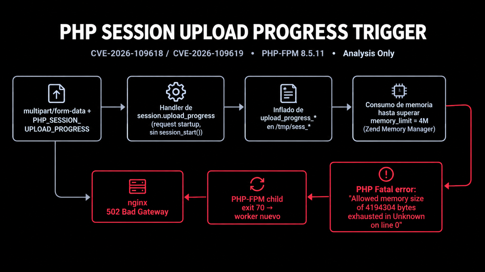

# Análisis del desencadenante - CVE-2026-109618 / CVE-2026-109619



> **[VER DISCLAIMER / AVISO LEGAL](DISCLAIMER.md)**  
> ÚNICAMENTE para uso educativo en entornos locales aislados (`127.0.0.1`). Uso indebido puede ser ilegal.

> **Nota:** Este laboratorio **NO** reproduce la explotación completa de *php2shell*. Únicamente analiza **el desencadenante** (`session.upload_progress` + agotamiento de memoria) de **CVE-2026-109618 / CVE-2026-109619**. La explotación completa por corrupción de heap queda fuera de alcance. Para verla, consulta el [repositorio original de Joas A Santos (@c0d3cr4zy)](https://github.com/joas-santos/php2shell).

Análisis local, aislado y no explotativo del desencadenante de CVE-2026-109618 / CVE-2026-109619. El fallo ocurre durante el *request startup* de PHP, al procesar el cuerpo `multipart/form-data` con `PHP_SESSION_UPLOAD_PROGRESS`, **antes** de ejecutar cualquier script de la aplicación.

## 1. Objetivo

Observar, documentar and generar evidencias de:

- Escritura del archivo de sesión `sess_*` sin necesidad de `session_start()`
- Inflado del array `upload_progress_*` durante el parseo multipart
- Agotamiento de `memory_limit` (4M) gestionado por el Zend Memory Manager
- Muerte del worker PHP-FPM con `exit code 70` y su posterior *respawn*
- Respuesta `502 Bad Gateway` desde nginx
- Diferencia entre el OOM de PHP (Zend MM) y un OOM del kernel

## 2. ¿Cómo funciona?

El handler de `session.upload_progress` se invoca **antes** de que PHP compile o ejecute the script destino. Al recibir el campo `PHP_SESSION_UPLOAD_PROGRESS`, PHP abre/crea el archivo de sesión correspondiente al `PHPSESSID`, deserializa su contenido, actualiza el array de progreso con los datos de cada parte `multipart` y lo vuelve a serializar.

Con un cuerpo lo suficientemente grande o con muchas partes, esa re-serialización se repite en cada *tick* y el consumo de memoria crece rápidamente. Al superar `memory_limit`, Zend MM provoca un `Fatal error: Allowed memory size exhausted in Unknown on line 0`, el worker de PHP-FPM finaliza con código `70` y el maestro lo reemplaza por uno nuevo. Nginx, al perder la conexión con the upstream FastCGI, devuelve `502 Bad Gateway`.

## 3. Levantar el entorno

```bash
# Vulnerable (PHP 8.5.11 + PHP-FPM + nginx)
docker compose up -d
docker compose ps
curl -sS http://127.0.0.1:8080/health.php  # ok pid=... limit=4M
```

## 4. Reproducir el desencadenante

```bash
# Modo más directo para observar the OOM
python3 trigger.py --url http://127.0.0.1:8080/ --mode progress
```

Respuesta esperada: `HTTP 502 Bad Gateway`. En los logs de PHP-FPM se verá el `Allowed memory size exhausted in Unknown on line 0`, `child ... exited with code 70` y `child ... started`.

## 5. Evidencias a observar

```bash
# Logs PHP-FPM
docker compose logs --since=2m php

# Logs nginx
docker compose logs --since=2m nginx

# Archivos de sesión escritos por el handler
docker compose exec -T php sh -c 'ls -l /tmp/sess_*; head -c 300 /tmp/sess_*'
```

## 6. Análisis a nivel SO

Para a análisis más detallado con `cgroups`, `/proc`, `strace`, montajes, inodos y trazado de procesos, sigue la guía:

- **[Actividad OS](lab/os-activity/README.md)**

## 7. Fuera de alcance

- **Heap grooming, corrupción controlada o estructuras falsas**: No se implementan.
- **Explotación completa (CVE-2026-109618 / CVE-2026-109619)**: Queda fuera de este repositorio. Ver [joas-santos/php2shell](https://github.com/joas-santos/php2shell).
- **Explotación vía aplicación web**: Este laboratorio se centra exclusivamente en el desencadenante, no en vectores de aplicación.

## 8. Referencias

- [PHP2Shell original por Joas A Santos (@c0d3cr4zy)](https://github.com/joas-santos/php2shell)
- [Wiz Research](https://www.wiz.io/blog)
- [PHP Manual - Session Upload Progress](https://www.php.net/manual/en/session.upload-progress.php)
